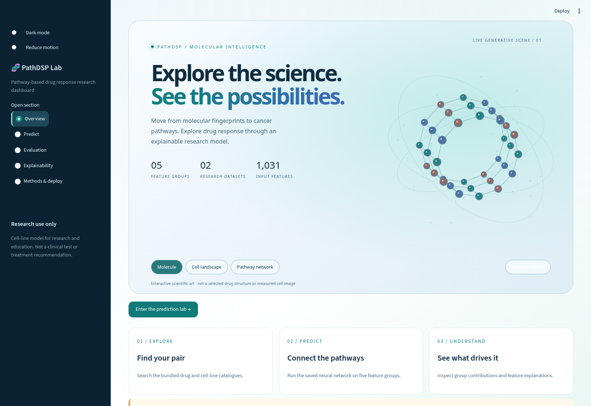
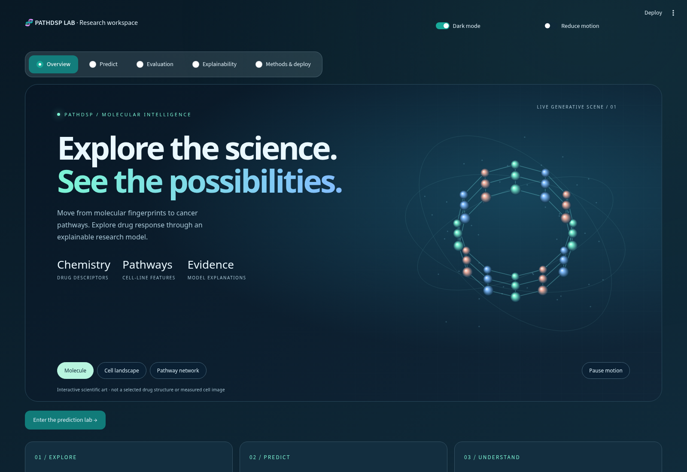

# Research release evidence and limits

This release is a hardened **research prototype**. It is not certified clinical
software and is not proven free of flaws. Software correctness, statistical
accuracy, and operational production readiness are separate properties.

## What was checked

- Twenty-nine integration/unit tests: navigation/search in both datasets, theme switching,
  prediction/observation separation, malformed/missing/infinite upload rejection,
  batch limits, archive-only loading, CSV feature-order consistency, serving-mode
  training protection, artifact corruption, external-transfer warnings, API readiness
  and request validation, populated samples, complete report export, ranking
  correctness, Windows JSON line-ending compatibility and backup-first recovery. Run `python -m unittest discover -s tests -v` after
  installing `requirements-api.txt`. The API test skips if optional dependencies
  are absent; a skipped test is not a validated API.
- Chromium: 1600px desktop and 390px mobile, both themes, all five sections,
  three animation scenes, pause, OS reduced motion, and actual prediction.
  Illustrations are locally generated scientific art, not verified structures.
- `outputs/data_quality_audit.json`: all 12 processed tables. Feature tables have
  no missing, infinite, nonnumeric or duplicate-ID values. Response matrices have
  unmeasured entries. GDSC excludes 2,633 measured pairs without all features;
  CCLE excludes 465. No labels were invented and no rows were removed to improve
  reported scores. Reproduce with `python scripts/audit_data.py`.
- `outputs/model_comparison.json` and `outputs/mse_training_comparison.json`: the historical tree trials did not beat the original FNN. The subsequent Xavier/AdamW/MSE FNN improved GDSC pair-holdout MAE from **0.321 to 0.310**, RMSE from **0.432 to 0.420**. The evaluated checkpoint is served directly. Model selection reused the historical holdout, so this is not fresh final validation. The screenshot example was a fitting row, not an independent test.
- `outputs/runtime_benchmark.json`: one warmed local HTTP API process with two
  PyTorch threads. Single-pair p95 about **3.7 ms**; 256-pair batch p95 about
  **149.0 ms**; 64 successful requests with eight clients, p95 about **22.5 ms**.
  Synthetic repeated pairs and a short run do not establish sustained public
  load capacity, WAN latency, uptime, or a service-level objective.
- GitHub Actions configuration runs the test suite and data audit on Linux;
  its hosted run status must be checked independently. Local test success does
  not establish hosted CI success. Docker rebuild and Windows execution were
  not validated in this release.

## Accuracy limits

The active deployment-model audit reports GDSC all-row MAE 0.195 and RMSE 0.275. This mixes fit/validation/holdout rows; use the explicit 0.310 MAE / 0.420 RMSE held-out result for generalization assessment, with the historical holdout-reuse caveat. No final refit contaminated the active checkpoint's held-out rows.

External CCLE MAE is **0.886**, RMSE **1.085**, R² **−0.524**; median concentration error is about **6.22×**. CCLE MAE worsened from the preceding deployment model's 0.866. GDSC all-row MAE also rose from 0.179 to 0.195 because the active checkpoint is fitted to fewer rows and keeps a larger held-out set. These all-row scores are not comparable generalization estimates. The new release improves the common GDSC pair-holdout scores but does not solve cross-study reliability.

The screenshot example improves from 16.51 μM to about 190 μM against 217.8 μM measured, but it was a fitting row. A one-unit log-response error means tenfold concentration error. There are no validated common patient-response, dosing or toxicity cutoffs. Safe duration, risk of death and treatment cost are unavailable from these data. Scale visualizations are descriptive assay context, not a clinical decision rule.

To improve external accuracy credibly: define the intended assay and use case;
harmonize assay units, dose caps and identifiers using source metadata; evaluate
study-aware calibration or retraining using separate training, validation and
untouched external test cohorts; run drug/cell holdouts and repeated seeds;
estimate uncertainty and out-of-distribution performance. Do not tune using the
reported test labels, silently clip responses, replace estimates with observations,
or promise clinical benefit. The current repository alone cannot establish these
claims, and raw archives are not needed for the current bundled workflow.

## Serving and scaling

The dashboard disables retraining unless `PATHDSP_ENABLE_TRAINING=1` is explicitly
set for a local research session. Keep production replicas read-only. Train in a
separate process, validate a candidate, and release the model, metadata and
`manifest.json` together; restart replicas to load a new version. The manifest
checks consistency against accidental corruption; it is not a digital signature
or protection against an attacker who can rewrite all files.

Optional inference service:

```bash
python -m pip install -r requirements-api.txt
OMP_NUM_THREADS=2 python -m uvicorn api:app --host 127.0.0.1 --port 8505 --workers 1
```

On PowerShell set `$env:OMP_NUM_THREADS='2'` first, then use
`.\.venv\Scripts\python.exe -m uvicorn api:app --host 127.0.0.1 --port 8505 --workers 1`.
`GET /health/ready` runs representative inference on both datasets; an open port
alone is not a readiness check. `POST /v1/predict` accepts `dataset` (`GDSC` or
`CCLE`) and `pairs` (1–256 objects with `drug` and `cell`). Identifiers are
case-insensitive. API docs are available at `/docs` on that local service.

The model/datasets are cached per process. A semaphore allows two simultaneous
forward passes per process and times out queued inference after ten seconds.
Process memory scales with worker/replica count; measure before adding workers.
Unknown IDs return 422; unavailable inference returns 503. Responses include a
model hash, measured response where available, comparison errors and limitations.
Dashboard feature uploads are limited to 20 MB and 2,048 rows. Blank features up
to 20% per row use training medians; bad text and infinity are rejected. A
heuristic scaling warning is not a calibrated uncertainty estimate.

Before an **internet-facing** deployment, supply and test TLS, authentication,
rate limiting, a reverse-proxy body limit (e.g. 1 MB for this pair-only API),
request timeouts, health-based routing, monitoring, resource budgets, backup and
rollback procedures, and sustained load/error-recovery tests on the actual host.
The API intentionally defaults to loopback; these external infrastructure
controls are not supplied by the Python app. Do not expose it publicly and call
that production-ready. The dashboard's native session connections also require
appropriate proxy WebSocket support and per-instance resource limits.

## Dependencies and updating Windows

`constraints-tested.txt` records tested direct dependency versions for Linux /
Python 3.12; it is not a complete lockfile or a Windows compatibility guarantee.
Use `pip check` after installation. Existing Windows installations can continue
using the repository's version ranges and should run the included tests.

```powershell
Set-Location -LiteralPath 'C:\Users\vaish\3-1_PS_Skilling\3-1_PS_Project(Drug_Sensitivity_Prediction)'
# Stop Streamlit with Ctrl+C first; preserve any local Git changes.
git pull --ff-only origin main
.\.venv\Scripts\python.exe -m pip install -r requirements.txt
.\.venv\Scripts\python.exe -m unittest discover -s tests -v
.\.venv\Scripts\python.exe -m streamlit run app.py
```

Untracked local `processed_data/` tables cannot override the committed bundle.
Neither `input.zip` nor `PathDSP-main.zip` is read by the app, API, or audits.
The committed compact `app_data/pathdsp_core.zip` is needed. Keep it and the
`ui/`, `pathdsp/`, and `artifacts/` directories when deploying.

## Report and Windows compatibility update

Navigation is horizontal. Evaluation includes pair-specific research rankings,
pathway/group SHAP, full self-contained HTML and evidence-ZIP downloads. Patient
health is unavailable and is never inferred. JSON hashing ignores only CRLF/LF
line-ending differences; real metadata corruption still fails. The recovery helper
backs up local files before restoring a verified committed bundle.

## Visual review

Screenshots captured in Chromium from the running app:

| Light workspace | Dark workspace |
| --- | --- |
|  |  |

[Mobile light workspace](screenshots/mobile-light.png).

[Structured report preview](screenshots/report-preview.png). The standalone HTML
embeds every figure and full expandable tables. The ZIP contains untruncated CSVs
and PNGs. Browser validation downloaded and reopened the report and checked all
embedded images. Separate CCLE pair evaluation, rankings and pathway SHAP were
also exercised. No patient health records or treatment efficacy were inferred.


## Interactive coordinate/report validation

The trained model and statistical results are unchanged by this presentation update.
All existing evaluation PNG figures have data-backed interactive equivalents.
Regression checks verify complete holdout/external scatter point counts, histogram
counts, confusion-matrix totals, correlation values, safe JSON embedding, complete
embedded CSV exports and immutable capture of generated session results.

Browser checks exercised linear, logarithmic, categorical and second-subplot
coordinates, real batch/SHAP generation and report downloads in light/dark themes.
The downloaded HTML was reopened with external requests blocked: coordinate
readouts and the correlation heatmap worked without a CDN or inference server.
Scientific cursor positions are differentiated from exact observed data marks.
Report previews do not limit CSV rows. The report includes five-section scientific
content and generated session outputs; deployment instructions are excluded.
Printed/PDF/PNG output is static, so pointer interactions require the HTML report.


The Evaluation page now renders only the three specified agreement plots, while
all charts remain in the report. Density-bin totals are verified against every
GDSC/CCLE evaluation row, and every UI table is registered in the shared export
payload and its completeness inventory. Shared Overview/Methods text prevents
app/report drift. The report includes the complete interpretation guide and
captured generated reports; missing patient/clinical data are never invented.
